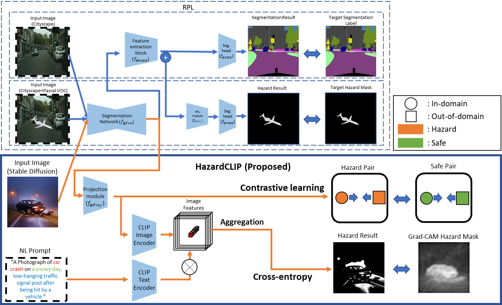
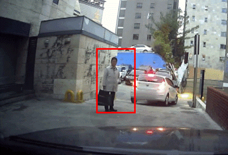

## 📸 Gallery
  

Pixel‑wise logit variance drives a segmentation network that spots debris and potholes while quantifying risk for autonomous vehicles.

**Highlights**
- Pixel-wise logit variance produces interpretable uncertainty maps
- Iterative background highlighting refines anomaly localization
- Evaluated for road-anomaly segmentation in the published ICRA study

**Publications**
- *Road anomaly segmentation based on pixel‑wise logit variance with iterative background highlighting*, ICRA 2023
